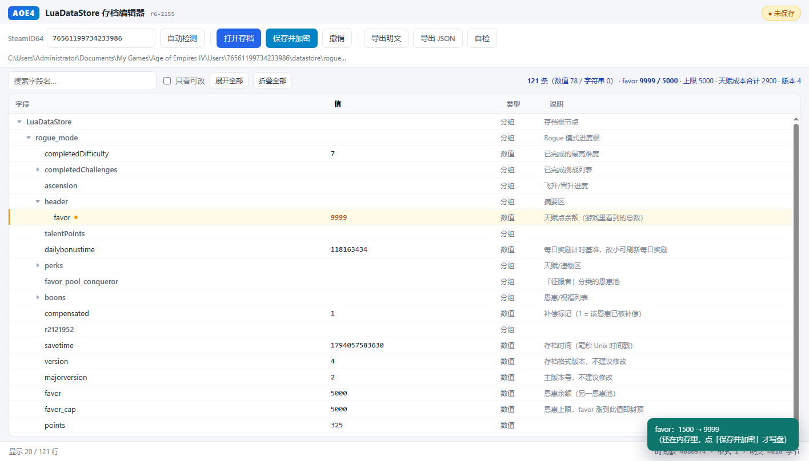

# AoE4 Save Editor (LuaDataStore .rlc)

A small utility for viewing and adjusting numeric fields in your own **local, single-player**
Age of Empires IV save file (`rogue_mode.rlc`).

- Reads and writes only save files the game itself created — it does **not** modify the game,
  does not access the network, and does not inject into any process.
- Every save automatically creates a `.bak` backup and verifies the result by reading it back.
- Split frontend/backend: a Python REST API on the back end, the UI runs in your browser.



## Before you start

This tool is meant for **your own account, on your own machine, with single-player saves** —
repairing a stuck run, adjusting a value, that sort of personal use. Please confirm:

1. **Your own saves only.** Do not use it on save files belonging to someone else.
2. **Single-player / offline only.** Do not use it in online matches.
3. **Fully quit the game before saving.** While it is running, the game writes its in-memory
   progress back to the save file and will overwrite your changes.
4. **Back up first.** The tool creates a `.bak` automatically, but copying the whole
   `datastore` directory somewhere safe is still a good idea.
5. **Use at your own risk.** Editing a save may be against the game's terms of service, and an
   out-of-range value can leave your progress in a broken state.

This project does not modify the game executable and does not bypass any online validation or
anti-cheat mechanism.

## Making your changes take effect: `-noCloudSaves`

Progress is synchronised through Steam Cloud. If you only change the local file, the cloud copy
may be restored on top of it at launch — which looks exactly like "my edit did nothing".

Steps:

1. Fully quit the game (check Task Manager for leftover processes).
2. In your Steam library, right-click **Age of Empires IV** → **Properties** → **General** →
   **Launch Options**.
3. Enter:

   ```
   -noCloudSaves
   ```

4. Launch the game and check the result.

`-noCloudSaves` only affects cloud sync for that launch; it does not delete anything already in
the cloud. To turn sync back on, clear the launch option — but save once in-game first so the
local file gets uploaded, otherwise an older cloud copy may overwrite it.

## Layout

```
aoe4_rlc/
├── aoe4_rlc.py          Entry point: CLI encrypt/decrypt + start the backend
├── aoe4_rlc_core.py     Core library: format parsing and encryption (pure functions, no UI/network/logging)
├── aoe4_rlc_server.py   Backend: JSON REST API + serves the web/ static files
├── web/                 Frontend (plain HTML/CSS/JS, no build step)
│   ├── index.html
│   ├── style.css
│   └── app.js
├── docs/                Screenshots
└── run.bat              Double-click to start
```

## Requirements

```bat
pip install pycryptodome
```

## Usage

### Web UI (recommended)

```bat
python aoe4_rlc.py
```

The backend picks a free port on `127.0.0.1` and opens your browser (starting at 8765).
Options:

```bat
python aoe4_rlc.py --port 8765      :: use a specific port
python aoe4_rlc.py --no-browser     :: serve only, do not open a browser
```

In the UI:

- Enter your SteamID64 (or click **Auto-detect**), then click **Open save**
- **Double-click the "Value" cell** in the tree table to edit in place; Enter commits, Esc cancels
- Click **Save & encrypt** to actually write to disk (creates a `.bak` and verifies the round-trip)
- Ctrl+O open / Ctrl+S save / Ctrl+F search / Ctrl+Z undo / F5 reload

### Command line

```bat
python aoe4_rlc.py <account-id> <file.rlc> [out.bin]              :: decrypt
python aoe4_rlc.py --encrypt <account-id> <file.bin> [out.rlc]    :: encrypt
```

## Backend API

| Method | Path | Description |
| --- | --- | --- |
| GET | `/api/state` | Full session state, including the field tree |
| GET | `/api/candidates` | Scan this machine for `.rlc` saves |
| GET | `/api/selftest` | Self-check |
| POST | `/api/open` | `{path, account}` — open a save |
| POST | `/api/edit` | `{index, value}` — change one field (in memory only) |
| POST | `/api/revert` | `{index}` — restore a field to its on-open value |
| POST | `/api/undo` | Undo the last change |
| POST | `/api/save` | `{account}` — re-encrypt, write, and verify |
| POST | `/api/close` | Close the current save |
| POST | `/api/export` | `{kind: "plain" \| "json"}` — export next to the source file |

Security: binds to `127.0.0.1` only, validates the `Host` header against DNS rebinding,
requires `application/json` on POST, and serves static files from a whitelist. No logs are
written.

## Save format

`.rlc` is the game's own Lua data-store format. The tool reads and writes it as follows:

- The whole file is **AES-256-CBC** ciphertext with PKCS#7 padding.
- The key is derived from the account ID: CityHash64 of the ID, concatenated with a fixed
  tail, fed through OpenSSL's `EVP_BytesToKey` (SHA-1, 4 iterations) to produce a 32-byte key
  and a 16-byte IV.
- The account ID is the decimal number in the `Users\<SteamID64>\` directory name.
- The decrypted container is `u32 timestamp | u8 version | chunk stream`, where each chunk is
  `tag(u32) + payload`: `tag 4` is a string `{u32 length, bytes}` and `tag 3` is a number
  `{u8 subtype, i64}`.

Field parsing uses local pattern matching: it only recognises number/string records that
immediately follow a field name, and does not attempt full table-structure inference. Saving is
therefore a **byte-exact in-place rewrite** — anything unrecognised is preserved untouched.

## License

[MIT](LICENSE) © 2026 StackAndPointer
